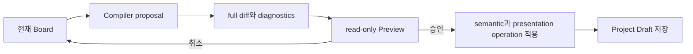

# SketchCatch UI design contract

이 문서는 현재 SketchCatch Web의 시각 및 interaction 기준을 설명합니다. token의 source of truth는 `apps/web/app/globals.css`, landing은 `apps/web/features/landing/product-entry.module.css`, Board는 `apps/web/features/diagram-editor/diagram-editor.module.css`입니다.

## 실제 화면 기준

mockup보다 실제 route와 component를 우선합니다. 문서 image가 current Web과 다르면 code를 기준으로 image와 설명을 갱신합니다.

## 색상

| 역할 | token | 값 |
| --- | --- | --- |
| page canvas | `--color-canvas` | `#ffffff` |
| primary text | `--color-ink` | `#171717` |
| body text | `--color-body` | `#55585f` |
| muted text | `--color-muted` | `#60646c` |
| primary action | `--color-primary` | `#000000` |
| text link | `--color-text-link` | `#0d74ce` |
| soft surface | `--color-surface-soft` | `#fafafa` |
| strong surface | `--color-surface-strong` | `#f0f0f3` |
| default line | `--color-hairline` | `#f0f0f3` |
| error | `--color-error` | `#b42318` |
| success | `--color-success` | `#067647` |
| warning | `--color-warning` | `#8a4b08` |

Landing은 흰 canvas와 near-black text를 기본으로 사용합니다. blue는 inline link와 Board action처럼 의미가 있는 interactive state에 제한합니다.

Architecture Board는 별도 board token을 사용합니다. canvas는 `#f6f8fc`, ink는 `#172033`, primary selection은 `#1f6feb`입니다. 이 색을 landing 전체 brand action으로 확장하지 않습니다.

## Typography

`Pretendard`를 Korean-first sans family로 사용합니다. code sample도 기본적으로 같은 family를 사용해 화면 안에서 font가 불필요하게 바뀌지 않게 합니다.

Heading은 정보 hierarchy를 만들고 body는 1.5 안팎 line-height를 유지합니다. 작은 label만 uppercase English를 허용하며 Korean copy에는 임의 letter spacing을 넣지 않습니다.

## 공간과 형태

기본 spacing은 4px 배수입니다. control radius는 8px, card는 12px, 큰 frame은 16px입니다.

Card는 shadow보다 border와 surface 차이로 hierarchy를 만듭니다. Board object는 selection과 dependency를 읽어야 하므로 landing card보다 선명한 border와 selected state를 사용합니다.

## Landing

Landing은 다음 순서로 읽힙니다.

1. 제품이 해결하는 문제와 설계 시작 action
2. Requirement에서 Deployment까지의 7단계 흐름
3. Architecture Draft, Terraform Preview, Pre-Deployment Review
4. Reverse Engineering
5. managed deployment와 CI/CD delivery
6. login으로 이어지는 call to action

제품 frame에는 실제 SketchCatch Board와 Terraform, review state를 사용합니다. generic device mockup이나 다른 제품 화면을 사용하지 않습니다.

## Architecture Board

Board는 resource node, relation edge와 presentation frame을 구분합니다. Resource identity와 visual grouping을 같은 field로 처리하지 않습니다.

Auto Arrange와 Compiler proposal은 Preview를 먼저 만듭니다. 사용자가 적용하기 전에는 current Board와 Project Draft를 바꾸지 않습니다.

## 상태 표현

- loading은 진행 중인 실제 stage와 취소 가능 여부를 보여줍니다.
- empty state는 다음 action과 필요한 사전 조건을 함께 보여줍니다.
- error는 provider 원문이나 credential을 노출하지 않고 복구 action을 제공합니다.
- success는 server persistence 또는 provider 확인이 끝난 뒤에만 표시합니다.
- unknown state를 정상으로 바꾸지 않습니다.

## User-Accepted Change

AI와 자동화가 만드는 결과는 suggestion, preview와 applied state를 구분합니다. 버튼 label은 실제 side effect를 설명해야 합니다.

Cloud apply, Git PR, permission update와 cleanup은 대상, diff와 approval 상태가 확인된 뒤에만 활성화합니다. read-only 화면과 mutation action을 같은 강조 수준으로 보이지 않습니다.

## Responsive와 accessibility

- desktop에서는 Board와 side panel의 최소 폭을 보존합니다.
- 좁은 화면에서는 panel을 접고 primary task 순서대로 한 열에 배치합니다.
- touch target은 작은 icon만 남기지 않습니다.
- tab, dialog, accordion과 menu는 keyboard focus와 accessible name을 가져야 합니다.
- color만으로 warning, success와 selection을 구분하지 않습니다.
- motion reduction 설정에서는 장식 animation을 줄이고 상태 정보는 유지합니다.

## 문서 image 관리

README image는 current route를 직접 캡처하거나 source revision이 기록된 evidence에서 가져옵니다. account ID, credential, private URL, AWS identifier와 사용자 data는 image에 넣지 않습니다.

UI 변경 뒤에는 image path, alt text, current token과 actual route를 함께 확인합니다. current code와 맞지 않는 image는 historical label 없이 재사용하지 않습니다.
