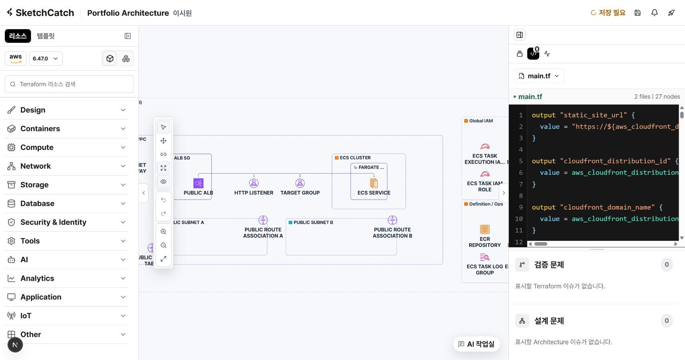
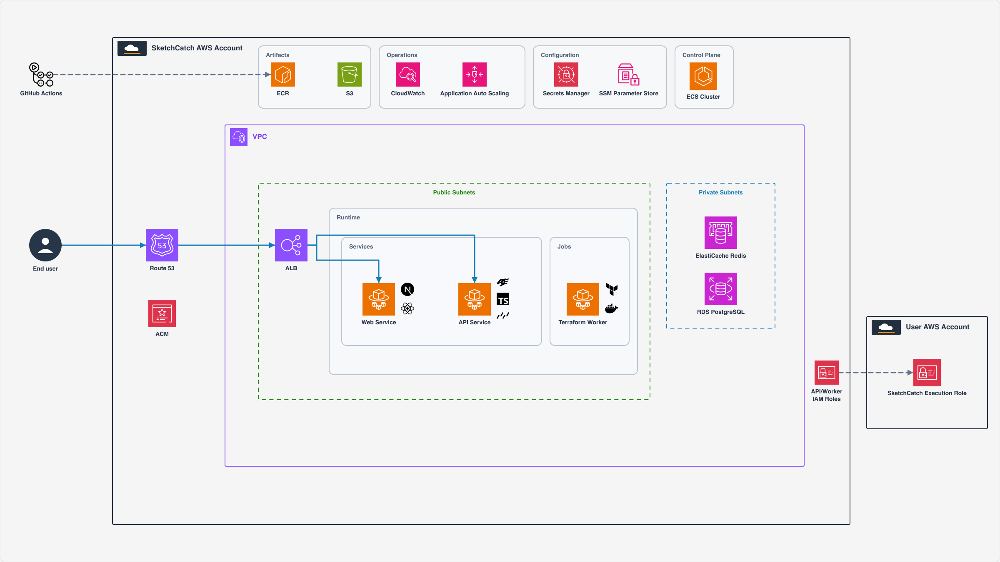

# SketchCatch

클라우드 구성을 다이어그램으로 편집하고 Terraform 코드로 배포하는 서비스입니다. 요구사항을 입력해 설계 초안을 만들거나 기존 저장소와 AWS 자원을 불러올 수 있습니다. 배포 전에는 비용과 보안 위험을 확인하고 실제 변경 내용을 승인합니다.

[서비스](https://sketchcatch.net) | [발표 영상](https://www.youtube.com/watch?v=a18RZGg8PyM) | [테스트와 배포 기록](./.eval/README.md) | [제품 문서](./docs/product.md) | [개발 가이드](./docs/development.md)

`TypeScript` `Next.js` `Fastify` `Terraform` `ECS Fargate` `PostgreSQL`



## 사용 흐름

1. 필요한 구성을 입력하거나 기존 Terraform 코드와 AWS 자원을 불러옵니다.
2. 다이어그램과 코드에서 자원과 연결 관계를 수정합니다.
3. 예상 비용과 보안 문제, 실제 변경 내용을 확인합니다.
4. 승인한 구성을 배포하고 진행 상태와 결과를 확인합니다. Git 저장소의 PR과 CI/CD로 전달할 수도 있습니다.

## 구현과 검증

### Terraform 변환 시 수정 내용 보존

그림과 코드가 자원을 따로 저장하면 코드에서 고친 값이 다음 생성 때 지워질 수 있었습니다. 두 편집기가 [같은 자원과 연결 정보](./apps/api/src/services/terraform/infrastructure-graph.ts)를 읽고 수정하도록 맞췄습니다. 변환할 수 없는 코드 블록은 지우지 않고 남깁니다. [그림과 코드를 오가는 변환 테스트](./apps/web/features/architecture-board-compiler/authored-terraform-round-trip.test.ts)로 수정 내용과 미지원 블록이 유지되는지 확인합니다.

### API 재시작 후 작업 추적

AWS에 배포 실행을 요청한 직후 API가 꺼지면 실행 식별자를 DB에 남기지 못할 수 있었습니다. 새 작업을 시작하면 이미 진행 중인 배포와 겹칠 위험이 있었습니다. [실행 요청](./apps/api/src/deployments/deployment-worker-dispatcher.ts)에 DB의 작업 번호를 함께 보내 같은 번호의 AWS 작업을 다시 찾도록 바꿨습니다. DB에서도 같은 배포의 진행 중인 작업을 하나로 제한합니다. [재시작과 중복 요청 테스트](./.eval/README.md#배포-작업-추적)에 확인 조건을 정리했습니다.

### 운영 배포 측정

API와 웹의 실행 이미지를 순서대로 만들면 앞 작업이 끝날 때까지 다음 작업이 기다려야 했습니다. 두 이미지를 병렬로 만들고 이전 빌드 결과를 재사용하도록 바꿨습니다. [보관한 배포 기록](./.eval/deployment-build-results.json)에서 이전 성공 4회의 전체 시간 중앙값은 470.5초였고 캐시를 준비한 뒤 배포한 1회는 369초였습니다. 서로 다른 커밋의 기록을 비교한 값이므로 [측정 조건](./.eval/README.md#운영-배포-측정)을 함께 확인할 수 있게 했습니다.

## 아키텍처

웹과 API는 AWS ECS Fargate에서 실행합니다. API는 승인된 배포마다 별도 Worker를 시작합니다. Worker는 사용자가 연결한 AWS 계정의 실행 권한으로 Terraform을 적용합니다.



프로젝트와 배포 상태는 PostgreSQL에 저장합니다. Terraform 파일과 실행 계획, 상태 파일은 S3에 보관합니다. Redis는 임시 진행 상태를 보조하며 배포 완료 여부의 기준은 DB와 AWS 조회 결과입니다. 서버 구성과 권한은 [아키텍처 문서](./docs/architecture.md)에 정리했습니다.

| 용도 | 기술 |
| --- | --- |
| 설계 편집 화면 | TypeScript, React, Next.js, React Flow |
| API와 배포 작업 처리 | TypeScript, Fastify, Terraform |
| 데이터 저장 | PostgreSQL, Drizzle ORM, S3 |
| 서비스 실행 | Docker, ECS Fargate, ALB |
| 빌드와 배포 | GitHub Actions, ECR |

## 배포 승인과 권한

설계를 수정하거나 AI 제안을 받아들이는 일과 AWS를 바꾸는 일은 분리했습니다. 배포 전 검사와 Terraform Plan으로 변경할 자원을 보여 주고 사용자가 승인한 계획을 Worker가 실행합니다. 승인 뒤 코드나 대상이 달라지면 같은 승인으로 실행할 수 없습니다.

사용자 저장소의 빌드 코드는 제한된 CodeBuild 역할에서 실행합니다. 실제 배포 권한은 Worker에 두고 빌드 결과의 대상과 내용을 다시 확인한 뒤 배포합니다. 자세한 권한 범위는 [빌드와 배포 권한 분리](docs/architecture.md#빌드와-배포-권한)에 있습니다.

## 로컬 실행

<details>
<summary>개발 환경 설정</summary>

Docker와 저장소에 지정된 pnpm 버전이 필요합니다.

```bash
pnpm install
cp .env.example .env
docker compose -f infra/local/docker-compose.yml up -d
pnpm dev
```

기본 주소는 Web `http://localhost:3000`, API `http://localhost:4000`입니다. 환경 변수 기준은 [`.env.example`](./.env.example)에서 확인할 수 있습니다.

</details>

<details>
<summary>검증 명령</summary>

```bash
pnpm harness:check
pnpm lint
pnpm typecheck
pnpm build
pnpm test
```

</details>

## 관련 문서

- [제품 범위와 로드맵](./docs/product.md)
- [시스템 아키텍처](./docs/architecture.md)
- [데이터 모델](./docs/data-models.md)
- [개발 가이드](./docs/development.md)
- [배포와 안전 정책](./docs/deployment.md)

## 팀원별 담당

| 팀원 | 주요 영역 | 핵심 기여 |
| --- | --- | --- |
| 송채강 | Frontend, Backend | 관리형 배포와 실시간 관측, 설계 보드와 저장소 연결 화면 |
| 이시원 | 팀장, Infrastructure, CI/CD, Backend | 설계와 코드 동기화, 배포 실행과 재시작 추적, AWS 운영 환경 |
| 이경근 | Frontend, Backend, 공용 타입 | 설계 보드와 Workspace AI, 기존 자원 조회와 Terraform 및 템플릿 매핑 |
| 고윤서 | Frontend, Backend, Database | 로그인과 JWT, 회원과 프로젝트 계정 관리, 설정과 AWS 연결 화면 |
| 이정현 | Frontend, Backend, CI/CD | CI/CD 전달과 준비 상태 점검, 설정 자동화와 배포 화면, 프로젝트 초안 관리 |
