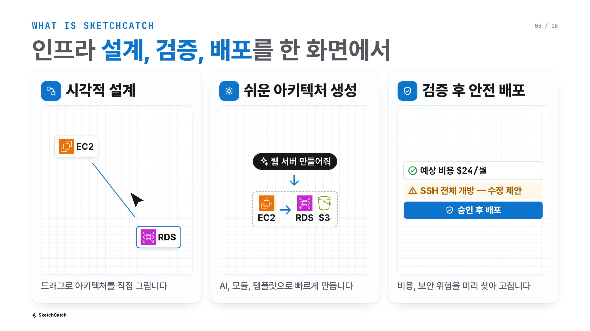
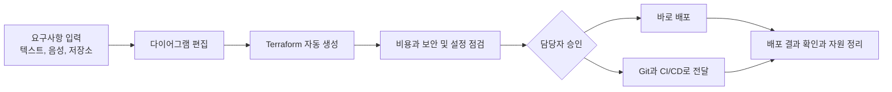
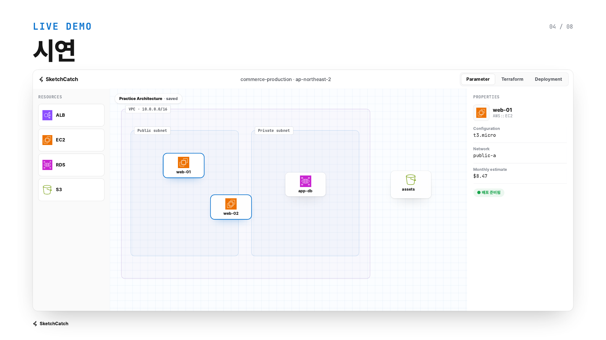
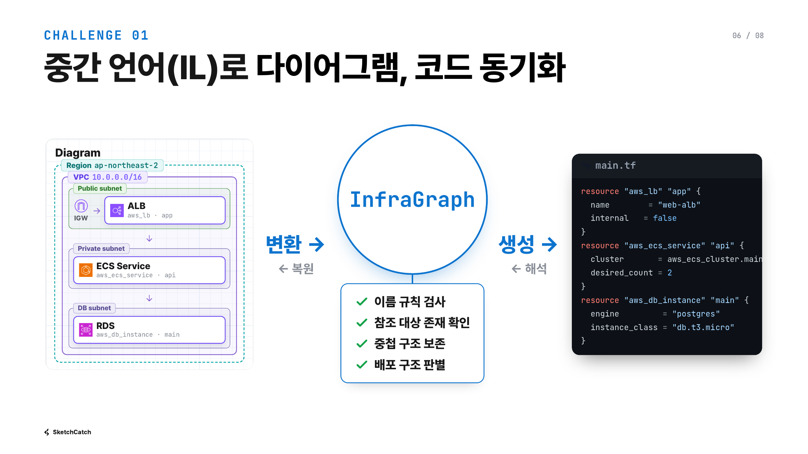
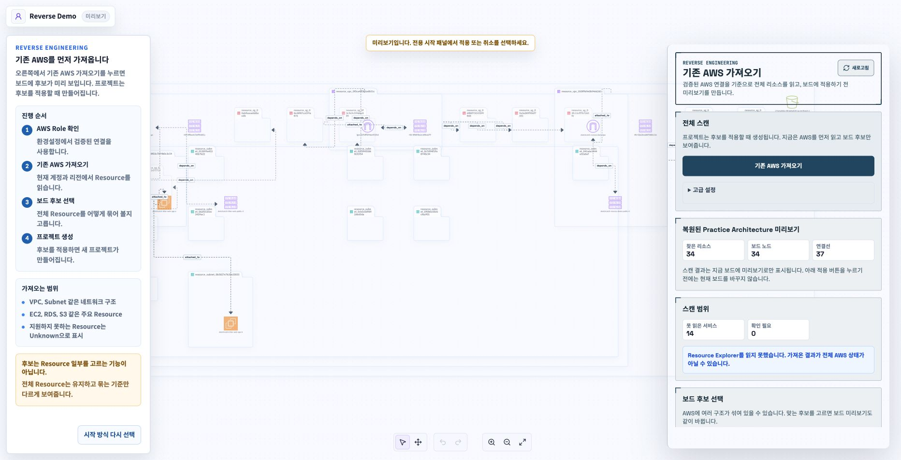
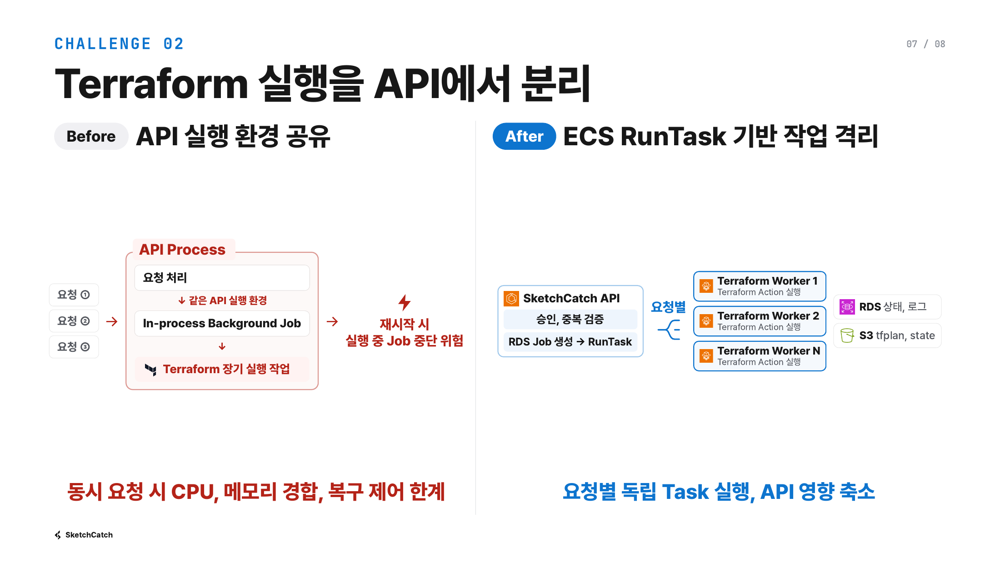
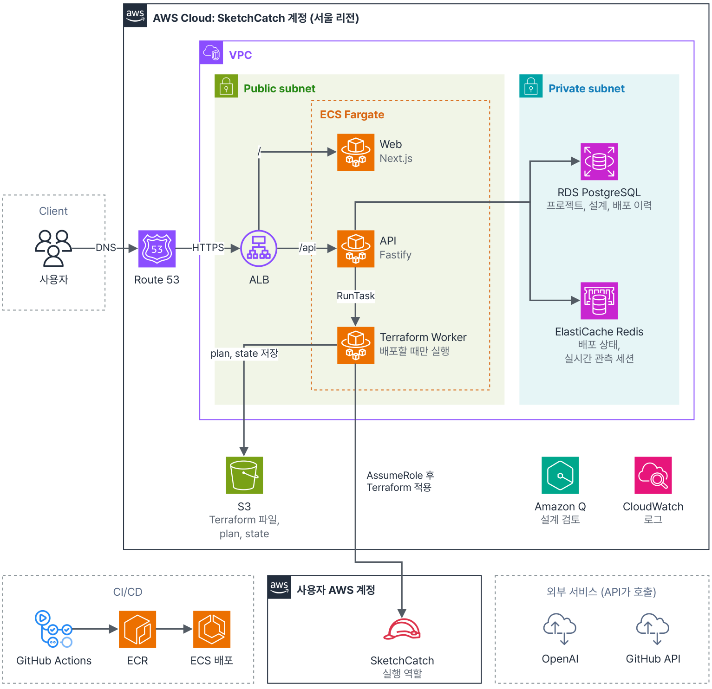

# SketchCatch

<p align="center">
  
</p>

클라우드 구성을 다이어그램으로 편집하고 Terraform 코드로 배포하는 서비스입니다. 요구사항을 입력해 설계 초안을 만들거나 기존 저장소와 AWS 자원을 불러올 수 있습니다. 배포 전에는 비용과 보안 위험을 확인하고 실제 변경 내용을 승인합니다.

[서비스](https://sketchcatch.net) | [제품 문서](./docs/product.md) | [개발 가이드](./docs/development.md)

`Next.js` `TypeScript` `Terraform` `AWS` `PostgreSQL`



## 배포 흐름

요구사항 입력부터 설계 편집과 배포 결과 확인까지 같은 프로젝트에서 진행합니다. 승인한 변경은 서비스에서 직접 실행하거나 Git Pull Request와 CI/CD로 전달합니다.



## 주요 기능

### 요구사항 기반 설계



텍스트나 음성으로 필요한 구성을 설명하거나 템플릿을 선택합니다. AI가 제안한 초안에서 자원과 연결 관계를 확인하고 수정할 수 있습니다.

### 다이어그램과 Terraform 동기화



다이어그램을 편집하면 Terraform 코드에 반영됩니다. 가져온 Terraform 코드도 다이어그램으로 변환해 편집할 수 있습니다.

### 기존 AWS 자원 조회



운영 중인 AWS 자원과 연결 관계를 읽어 다이어그램으로 불러옵니다. 조회 결과를 미리 확인한 뒤 필요한 설계에 적용합니다.

### 배포 검토와 실행



예상 비용과 외부 접근 허용 여부, 권한을 배포 전에 점검합니다. 승인된 작업은 별도 Worker에서 실행하고 결과와 로그를 기록합니다.

### 기능 목록

| 기능 | 내용 |
| --- | --- |
| 설계 초안 | 자연어와 음성 요구사항, 템플릿 또는 소스 저장소를 바탕으로 생성 |
| 설계 편집 | 자원과 네트워크 연결 및 설정 확인과 수정 |
| Terraform 생성 | 설계를 Terraform 파일과 실행 계획으로 변환 |
| 배포 점검 | 예상 비용과 보안 위험 및 변경 내용 확인 |
| 배포 실행 | 승인 후 직접 실행하거나 Git Pull Request와 CI/CD로 전달 |
| 이력 관리 | 배포 상태와 로그 및 출력값 기록, 변경 이력 확인과 자원 정리 |

## 인프라 아키텍처

서울 리전의 ECS Fargate에서 Web과 API를 운영합니다. 사용자 요청은 Route 53과 ALB를 거쳐 Web의 `/` 또는 API의 `/api`로 전달됩니다.



- Web과 API는 NAT Gateway 비용을 줄이기 위해 Public Subnet에 두고 ALB 요청만 받습니다.
- RDS PostgreSQL과 ElastiCache Redis는 Private Subnet에 둡니다. DB는 프로젝트와 설계 및 배포 이력을 저장하고 Redis는 배포 상태와 실시간 관측 세션을 관리합니다.
- API가 ECS RunTask로 Terraform Worker를 시작합니다. Worker는 배포할 때만 실행되며 사용자 AWS 계정의 실행 역할을 AssumeRole로 받아 Terraform을 적용합니다. Terraform 파일과 plan 및 state는 S3에 보관합니다.
- API는 OpenAI와 GitHub API를 호출하고 Amazon Q는 설계 검토를 보조합니다. 실행 로그는 CloudWatch에 남깁니다.
- GitHub Actions는 OIDC 임시 권한으로 ECR에 이미지를 올리고 ECS에 배포합니다.

현재 배포 대상은 AWS이며 Terraform을 사용합니다. 다른 클라우드도 지원할 수 있도록 설계 데이터와 클라우드별 실행 코드를 분리했습니다.

## 기술 스택

| 영역 | 기술 | 하는 일 |
| --- | --- | --- |
| 사용자 화면 | Next.js, React, TypeScript | 설계 편집과 코드 미리보기, 배포 검토와 승인 |
| API | Fastify, TypeScript | 프로젝트와 설계 관리, 배포 요청 처리와 권한 확인 |
| 데이터 | PostgreSQL, Drizzle ORM | 프로젝트 상태와 승인 기록, 배포 이력 저장 |
| 파일 보관 | Amazon S3 | Terraform 파일과 실행 계획, 상태 파일과 생성 결과물 보관 |
| 인프라 자동화 | Terraform | 설계를 인프라 코드로 변환하고 실행 |
| AI | OpenAI API, AWS Bedrock, Amazon Q | 요구사항 해석과 설계 제안, 오류 설명과 위험 검토 |
| 실행 환경 | Docker, Amazon ECS/Fargate, ALB | Web과 API 및 배포 Worker 운영, 요청 전달 |
| 자동 배포 | GitHub Actions, Amazon ECR | 코드 검증과 이미지 빌드, 서비스 배포 |
| 상태와 로그 | Redis, Amazon CloudWatch | 작업 진행 상태 전달, 로그와 지표 수집 |

## 배포 승인과 검증

AI가 제안한 설계는 사용자가 확인하고 수정합니다. 실제 배포는 코드 검증과 사용자 승인을 거친 뒤 실행합니다.

- 설계와 Terraform 코드의 구조 및 참조 관계를 검사합니다.
- 공개 저장소와 모든 주소에 열린 SSH, 외부에 공개된 DB와 과도한 권한을 점검합니다.
- 승인한 코드와 실행 계획 또는 대상 계정과 리전이 바뀌면 실행을 막습니다.
- 클라우드 자격 증명과 민감한 출력값은 화면과 응답 및 로그에서 숨깁니다.
- 실패한 작업의 상태와 로그를 남겨 복구하거나 자원을 정리할 때 확인할 수 있습니다.

## 로컬 실행

<details>
<summary>개발 환경 설정</summary>

Docker와 저장소에 지정된 pnpm 버전이 필요합니다.

```bash
pnpm install
cp .env.example .env
docker compose -f infra/local/docker-compose.yml up -d
pnpm dev
```

기본 주소는 Web `http://localhost:3000`, API `http://localhost:4000`입니다. 환경 변수 기준은 [`.env.example`](./.env.example)에서 확인할 수 있습니다.

</details>

<details>
<summary>검증 명령</summary>

```bash
pnpm harness:check
pnpm lint
pnpm typecheck
pnpm build
pnpm test
```

</details>

## 관련 문서

- [제품 범위와 로드맵](./docs/product.md)
- [시스템 아키텍처](./docs/architecture.md)
- [데이터 모델](./docs/data-models.md)
- [개발 가이드](./docs/development.md)
- [배포와 안전 정책](./docs/deployment.md)

## 팀원별 담당

| 팀원 | 주요 영역 | 핵심 기여 |
| --- | --- | --- |
| 송채강 | Frontend, Backend | 관리형 배포와 실시간 관측, 설계 보드와 저장소 연결 화면 |
| 시원 | Infrastructure, CI/CD, Backend | AWS ECS/Fargate와 RDS 및 S3 운영 환경, 배포 실행과 관측 검증 |
| 이경근 | Frontend, Backend, 공용 타입 | 설계 보드와 Workspace AI, 기존 자원 조회와 Terraform 및 템플릿 매핑 |
| 고윤서 | Frontend, Backend, Database | 로그인과 JWT, 회원과 프로젝트 계정 관리, 설정과 AWS 연결 화면 |
| 이정현 | Frontend, Backend, CI/CD | CI/CD 전달과 준비 상태 점검, 설정 자동화와 배포 화면, 프로젝트 초안 관리 |
