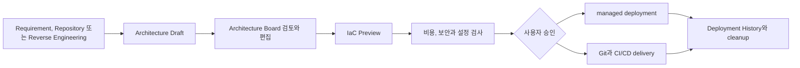
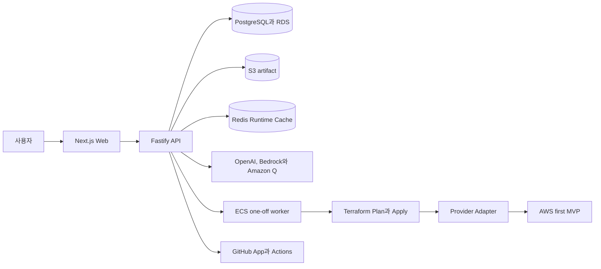
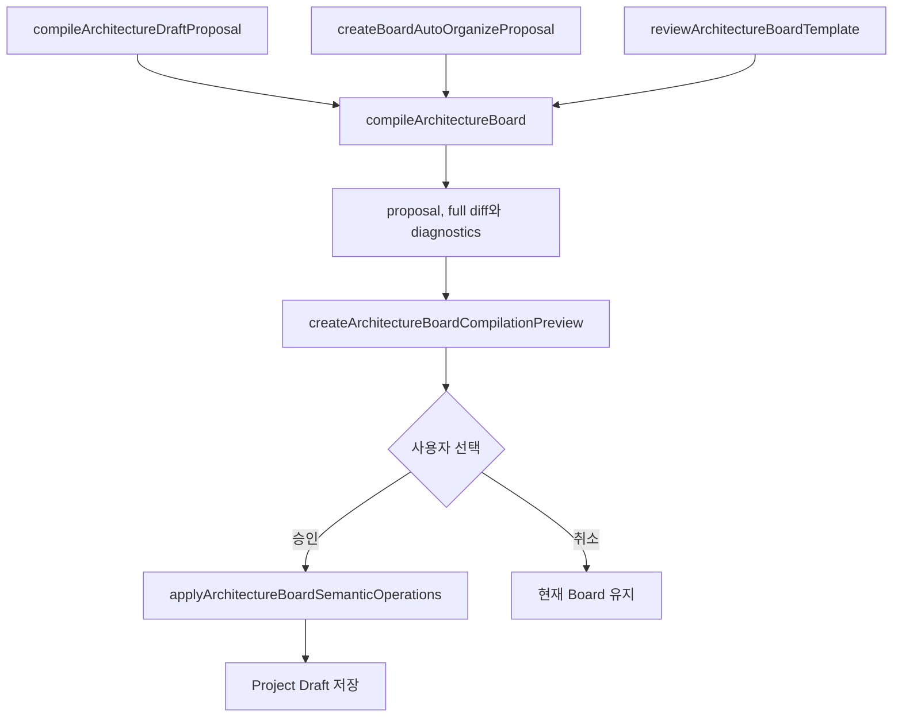

# SketchCatch

클라우드 요구사항, 기존 source repository 또는 운영 중인 AWS 환경을 검토 가능한 Architecture Board와 Terraform으로 연결하는 팀 기반 IaC operations service입니다.

[서비스](https://sketchcatch.net) | [제품 범위](./docs/product.md) | [아키텍처](./docs/architecture.md) | [개발 가이드](./docs/development.md)

| Architecture Board | Reverse Engineering |
| --- | --- |
|  |  |

두 화면은 서비스의 핵심인 설계 편집과 기존 AWS 구조 복원을 보여줍니다. 랜딩 전체 페이지나 로그인 화면은 제품 동작을 증명하지 못하므로 대표 화면에서 제외했습니다.

## 풀고 싶었던 문제

인프라 설계는 문서, diagram, Terraform, cloud console과 배포 pipeline에 흩어지기 쉽습니다. 요구사항이 바뀌면 그림과 코드가 어긋나고, 실제 적용 전에 비용과 공개 접근, IAM 위험을 함께 검토하기도 어렵습니다.

SketchCatch는 다음 과정을 하나의 승인 가능한 흐름으로 묶습니다.



AI는 제안을 만들 수 있지만 Board 저장, Terraform handoff, Git 변경과 Deployment 실행은 사용자가 승인해야 합니다.

## 핵심 구현 화면

| Diagram과 Terraform 동기화 | 격리된 Deployment worker |
| --- | --- |
|  |  |

## 시스템 구성



Web은 cloud SDK와 Terraform command를 직접 실행하지 않습니다. API가 project, approval, credential scope와 execution lease를 확인한 뒤 worker 또는 GitHub handoff로 전달합니다.

RDS는 project와 approval의 원천 기록을 보관하고 S3는 Terraform, plan, state와 generated artifact를 저장합니다. Redis는 사용자 infrastructure resource가 아니라 내부 Runtime Cache입니다.

## Architecture Board Compiler 관계



Compiler는 Resource, 관계, 설정, 소속과 시각 배치를 제안하지만 현재 Board를 직접 저장하지 않습니다. Preview에서 선택한 뒤 Project Draft 저장이 성공해야 적용 완료로 표시됩니다.

관련 source는 `apps/web/features/architecture-board-compiler`와 `apps/web/app/workspace/ai`에 있습니다. 세부 contract는 [data-models.md](./docs/data-models.md#architecture-board-compilation-제안-계약)에 있습니다.

## 문제 해결 과정

### 흩어진 설계 표현을 하나의 변경으로 검토하기

Diagram은 설계 검토를, Terraform은 실행 계획을, cloud state는 실제 결과를 나타냅니다. 세 표현이 따로 바뀌면 적용 전에 무엇을 검토했고 무엇이 달라졌는지 추적하기 어렵습니다.

그래서 Architecture Board를 Resource, 관계, 설정, 소속과 시각 표현을 함께 다루는 기준 모델로 뒀습니다. Compiler는 현재 Board를 바꾸지 않는 proposal과 전체 diff, diagnostics를 만들고 Preview가 변경 범주와 남은 확인 항목을 보여 줍니다.

사용자가 Preview에서 수락한 뒤에만 semantic과 presentation operation을 반영합니다. Project Draft는 `expectedRevision`을 확인해 저장하고, 저장 성공을 적용 완료로 표시하므로 저장 충돌이나 실패를 성공으로 바꾸지 않습니다.

`2026-08-23` 관련 4개 source-level test는 56/56 통과했고, Preview 수락 UI 연결은 source만 확인했으며 proposal non-mutation, Preview 요약, operation, `expectedRevision` save/conflict는 fresh test로 확인했습니다.

이 과정이 실제 cloud state와의 일치를 자동으로 보장하는 것은 아닙니다. 실제 cloud mutation은 승인된 Deployment 또는 CI/CD handoff의 별도 safety gate에서만 실행하며, Preview는 그 이전의 검토 경계입니다.

### 재시작될 수 있는 API에서 Terraform 실행 분리하기

Terraform Plan, Apply, Destroy처럼 오래 걸리는 작업을 API process에서 직접 실행하면 재시작이 실행을 끊을 수 있고, 같은 project의 managed deployment와 GitOps 실행이 서로 경쟁할 수 있습니다.

API는 `deployment_jobs`에 durable 상태를 기록하고 project execution lease와 fencing version으로 실행권을 확인합니다. active lease는 즉시 막고, 만료되거나 중단된 실행은 terminal 상태를 확인한 뒤에만 recovery가 새 실행권을 가질 수 있습니다.

production에서는 API가 ECS `RunTask`로 one-off worker를 dispatch합니다. worker는 job ID와 DB access context를 기준으로 `RUNNING` job만 실행하고, `SUCCEEDED`, `FAILED`, `CANCELLED`는 `deployment_jobs`의 terminal status로 기록합니다.

worker process는 중단 신호를 `AbortSignal`로 전달합니다. Apply가 중단되면 Deployment는 `FAILED`로 기록하고 partial Terraform state upload를 시도합니다.

partial state가 보관돼도 AWS resource가 일부 바뀌었을 수 있습니다. retry 전에는 해당 resource를 명시적으로 확인하고 cleanup이 필요한지 판단해야 하며, partial state upload 자체를 보장된 완료 순서로 보지 않습니다.

`2026-08-23` worker, lease, dispatcher test는 20/20, 선택한 interrupted-Apply test는 2/2 통과했습니다. job status, fencing, task inspection, Apply `FAILED`와 partial state 경계는 fresh test로 확인했으며 ECS `RunTask`의 live 실행은 source만 확인했습니다.

ECS worker가 실제 mutation을 대신 승인하는 구조는 아닙니다. 실행 전후의 승인, plan과 artifact 검증, account와 region 재확인은 유지하며, worker는 그 확인을 통과한 작업을 분리해 수행합니다.

## 핵심 선택

| 선택 | 이유와 경계 |
| --- | --- |
| Terraform-first | 검토한 설계를 반복 가능한 code와 plan으로 연결합니다. |
| AWS-first Provider Adapter | MVP 범위는 AWS지만 domain contract는 provider-neutral로 유지합니다. |
| User-Accepted Change | AI 제안과 실제 mutation 사이에 Preview와 승인 단계를 둡니다. |
| 격리 worker | API process에서 Terraform을 실행하지 않고 one-off task에 lease와 제한 권한을 줍니다. |
| RDS와 S3 분리 | structured state와 file artifact의 수명과 접근 방식을 분리합니다. |
| managed deployment와 CI/CD delivery | 즉시 실행과 팀 repository 절차를 같은 제품 안에서 선택할 수 있게 합니다. |

## 안전 경계

- 승인 시점의 code, plan, account, region 또는 target fingerprint가 바뀌면 실행하지 않습니다.
- public SSH, public database, 과도한 IAM과 unsafe Terraform reference를 적용 전에 찾습니다.
- credential, token과 raw provider error를 화면, API response와 log에 남기지 않습니다.
- real cloud mutation은 explicit Deployment 또는 승인된 CI/CD handoff에서만 수행합니다.
- 실패한 작업은 terminal state, redacted log와 cleanup 후보를 남깁니다.

## 팀 결과와 기여

SketchCatch는 기획, Web, API, database, infrastructure와 CI/CD를 여러 사람이 나눠 만든 팀 프로젝트입니다. 아래 표는 전체 Git ref의 non-merge commit과 변경 경로를 탐색 근거로 정리한 것이며 commit 수를 기여량 점수로 사용하지 않습니다.

| 팀원 | 주요 영역 | 확인되는 기여 |
| --- | --- | --- |
| 송채강 | Frontend, Backend | managed deployment, Live Observation, Architecture Board와 Repository UX |
| 이시원 | Infrastructure, CI/CD, Backend | ECS/Fargate, RDS, S3 기반과 배포 및 관측 안전 경계 |
| 이경근 | Frontend, Backend, shared types | Architecture Board, Workspace AI, Reverse Engineering과 Terraform Template mapping |
| 고윤서 | Frontend, Backend, Database | 로그인, 회원, project account와 Settings 및 AWS 연결 UX |
| 이정현 | Frontend, Backend, CI/CD | CI/CD handoff, readiness, setup 자동화와 Delivery 및 Project Draft 흐름 |

제품 전체, 전시와 배포 결과를 특정 팀원의 단독 성과로 표시하지 않습니다. 팀원별 세부 범위는 PR과 Git history에서 다시 확인할 수 있습니다.

## 로컬 실행

```bash
pnpm install
cp .env.example .env
docker compose -f infra/local/docker-compose.yml up -d
pnpm dev
```

기본 주소는 Web `http://localhost:3000`, API `http://localhost:4000`입니다. current dev의 landing은 backend 없이 render할 수 있지만 인증 이후 workspace는 API와 PostgreSQL이 필요합니다.

## 검증

### 2026-08-23 fresh checks

```bash
pnpm harness:check
pnpm lint
pnpm typecheck
pnpm build
```

위 check와 아래 focused test는 이 README 수정에서 새로 실행했다.

- Board: `architecture-board-compiler.test.ts`, `architecture-board-compilation-preview.test.ts`, `architecture-board-semantic-operations.test.ts`, `project-draft-sync.test.ts`는 56/56 통과했다.
- Worker: `deployment-worker-service.test.ts`, `deployment-worker-dispatcher.test.ts`, `project-execution-lease-service.test.ts`는 20/20 통과했다.
- Apply: partial-state failure를 고른 `deployment-apply-service.test.ts` 2개 test는 2/2 통과했다.

root `pnpm test`는 이 README 수정에서 다시 실행하지 않았다. live ECS, cloud mutation, ECS worker smoke도 실행하지 않았다.

historical only로 `agent-progress.md` 38행은 Web 1,378/1,394, API 2,186/2,227과 1 skipped, types 77/78 template check를 기록한다. 이 broad baseline은 이번 README 수정의 fresh 결과가 아니다.

## 문서

- [문서 안내](./docs/README.md)
- [제품 방향](./docs/product.md)
- [서비스 흐름](./docs/service-specification.md)
- [아키텍처](./docs/architecture.md)
- [데이터와 API contract](./docs/data-models.md)
- [개발 및 Git 절차](./docs/development.md)
- [Deployment 운영](./docs/deployment.md)
- [UI design contract](./DESIGN.md)

현재 지원 범위와 알려진 한계는 canonical 문서를 기준으로 합니다. 완료된 계획과 중간 보고서는 필요한 사실을 통합한 뒤 Git history에 남깁니다.
