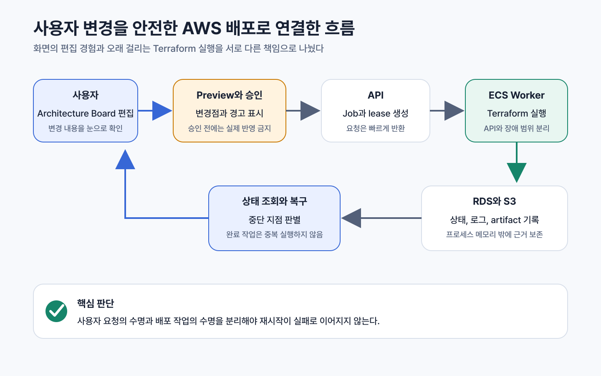

# SketchCatch

기존 코드와 AWS 자산을 Architecture Board로 가져와 Terraform 변경을 검토하고 배포하는 IaC 운영 서비스


SketchCatch는 AWS와 Terraform을 사용하는 개발자와 운영 팀을 위해 만들었습니다. 저장소 구조와 기존 클라우드 자산을 다시 입력하는 일을 줄이고, 자동화가 제안한 근거와 실제 변경 범위를 사용자가 확인할 수 있게 합니다.

사용자는 AI, GitHub 저장소, 기존 AWS 자산, 템플릿 중 하나에서 시작할 수 있습니다. 결과는 Architecture Board와 Terraform에서 함께 수정하며, Plan을 검토하고 승인한 뒤에만 AWS에 반영합니다.

현재 실제 연동과 배포를 검증한 범위는 AWS와 Terraform입니다. Azure와 GCP 연동은 아직 구현 범위에 포함하지 않았고 지원 확장 계획이 있습니다.

## 프로젝트 정보와 개인 역할

| 항목 | 내용 |
| --- | --- |
| 개발 기간 | 2026.06.18 - 2026.07.25 |
| 팀 구성 | 5인 팀, 팀장 |
| 개인 담당 | Board와 Terraform 양방향 동기화, Terraform Worker와 실행 복구, Production AWS 운영, CI/CD |
| 주요 기술 | TypeScript, Fastify, PostgreSQL, Terraform, AWS ECS/Fargate |

초기 화면을 실제 배포 흐름으로 연결하면서 두 문제가 드러났습니다. 사용자가 Board와 Terraform을 번갈아 고치면 한쪽의 수정이 다른 쪽에서 사라졌고, 수 분 걸리는 Terraform 작업을 API가 직접 실행하면 재배포나 프로세스 종료 때 작업 상태를 잃었습니다. 기능을 더 붙이기 전에 편집 결과의 일치와 실행 복구를 각각 독립된 문제로 나눴습니다.

## 개인 기여

| 문제 | 선택 | 확인한 결과 |
| --- | --- | --- |
| Board와 Terraform의 변경이 서로 덮어씀 | 공통 `InfrastructureGraph`와 리소스 ID를 사이에 두고 양방향 변환 | 지원 HCL은 동기화하고 해석할 수 없는 block은 원문을 보존한 채 diagnostic으로 반환 |
| API가 장기 Terraform 작업을 붙잡음 | API는 작업과 lease만 기록하고 실행은 one-off ECS Worker로 분리 | dispatch 실패와 API 재시작을 포함한 25개 복구 시나리오 통과 |
| Production API가 Runtime Cache에 연결되지 않음 | 전체 Plan을 적용하지 않고 API와 Worker security group ingress 2개만 변경 | 503이 예상한 404로 바뀌고 후속 Plan에서 `No changes` 확인 |
| 배포 시간이 길어 피드백이 늦음 | Web과 API image 병렬 build, ECR cache 사용 | 같은 commit의 warm cache 조건에서 최근 성공 4회 중앙값 7분 51초에서 6분 9초로 감소 |



## 작업 흐름

| 단계 | 사용자가 하는 일 | SketchCatch가 하는 일 |
| --- | --- | --- |
| 1. 시작 | AI, 저장소, AWS 자산, 템플릿 중 하나를 선택 | 기존 맥락을 읽고 아키텍처 후보와 근거를 제시 |
| 2. 설계 | Board와 Terraform을 검토하고 수정 | 두 형식의 리소스와 참조 관계를 동기화 |
| 3. 검증 | 비용, 보안, 설정과 Plan의 변경 범위를 확인 | 결정론적 검사와 Terraform Plan 실행 |
| 4. 배포 | Apply 또는 Git과 CI/CD 전달을 승인 | Terraform Worker 실행, 상태와 artifact 기록 |
| 5. 운영 | 배포 이력과 실시간 트래픽 관측 확인 | 실행 상태, 로그와 운영 지표 수집 |

## 네 가지 시작 방식

| 시작 방식 | 입력 | 결과 |
| --- | --- | --- |
| AI | 사용자 수, 공개 접근, 데이터 저장, 예산과 운영 방식 | 검토 가능한 아키텍처 초안 |
| GitHub Repository | 고정된 commit SHA의 제한된 파일 | 파일별 근거가 있는 배포 구성 추천 |
| Reverse Engineering | 검증된 AWS 연결, Region과 리소스 종류 | 새 자산, 변경 자산과 중복 가능성을 구분한 Board 후보 |
| Template | 검토된 반복 구조와 기본값 | 이름과 참조를 다시 매핑한 재사용 구성 |

저장소 분석은 대상 코드를 실행하지 않습니다. `package.json`, Dockerfile과 배포 설정을 정적으로 읽고, 근거가 부족하거나 후보가 여러 개면 사용자 선택을 기다립니다.

Reverse Engineering도 발견한 AWS 자산을 바로 적용하지 않습니다. Board에 추가하기 전에 변경 내용과 수동 확인 항목을 보여줍니다.

## 핵심 설계

| 문제 | 설계 선택 | 지키려는 기준 |
| --- | --- | --- |
| Board와 Terraform을 모두 수정할 수 있음 | 두 형식 사이에 `InfrastructureGraph`를 두고 양방향 변환 | 화면과 실제 배포 값의 일치 |
| Terraform 실행 중 API가 재시작될 수 있음 | ECS RunTask 기반 일회성 Terraform Worker와 RDS lease 사용 | 실행 상태 복구와 중복 Apply 방지 |
| 사용자 AWS 계정에 연결해야 함 | CloudFormation Quick Create, External ID, STS AssumeRole 사용 | 장기 Access Key를 저장하지 않는 연결 |
| AI 결과가 운영 변경으로 이어짐 | AI 제안, 결정론적 검사, 사용자 승인을 분리 | 근거와 변경 범위를 확인한 뒤 실행 |

지원하지 않는 HCL은 추측해서 Board에 반영하지 않습니다. 기존 값과 원문을 보존하고 진단을 반환합니다.

API가 Terraform Worker의 Task ARN을 저장하기 전에 종료돼도 Job ID가 담긴 `startedBy`로 기존 ECS Task를 다시 찾습니다. 승인한 artifact, tfplan hash, AWS account와 Region이 현재 실행 대상과 다르면 Apply를 막습니다.

## 검증한 결과

| 검증 대상 | 결과 | 측정 범위 |
| --- | --- | --- |
| Board와 Terraform 동기화 | 관련 테스트 111개 통과 | 그래프 생성, HCL 렌더링, 역동기화와 실패 처리 |
| Terraform Worker 복구 | 관련 시나리오 25개 통과 | dispatch 실패, API 재시작, ECS 조회 지연, 취소와 중복 실행 |
| 운영 배포 시간 | 7분 51초에서 6분 9초 | 최근 성공 4회 중앙값과 같은 commit의 warm cache 조건 비교, 21.7% 감소 |
| Live Observation 503 | Redis ingress 2개로 복구 | 무관한 `5 add, 7 change, 2 destroy` 제외, 예상한 404와 후속 Plan `No changes` 확인 |

## 실행 구조

| 영역 | 기술과 역할 |
| --- | --- |
| Web | Next.js, React, TypeScript, ECS/Fargate |
| API | Fastify, TypeScript, ECS/Fargate |
| Terraform Worker | ECS RunTask 기반 일회성 Task |
| Data | PostgreSQL/RDS, S3 artifact, Redis/ElastiCache runtime cache |
| Edge | ALB, Route 53, ACM |
| CI/CD | Docker, ECR, GitHub Actions OIDC/STS |

초기 EC2, SSM, Nginx 배포 경로는 종료했습니다. 현재 ALB가 Web과 API의 ECS 서비스를 직접 라우팅합니다.

## 로컬에서 실행하기

Docker와 pnpm이 필요합니다.

```bash
pnpm install
cp .env.example .env
docker compose -f infra/local/docker-compose.yml up -d
pnpm dev
```

Web은 `http://localhost:3000`, API는 `http://localhost:4000`에서 실행됩니다. 필요한 환경 변수는 [`.env.example`](./.env.example)에서 확인할 수 있습니다.

## 검증 명령

```bash
pnpm harness:check
pnpm lint
pnpm typecheck
pnpm build
pnpm test
```

## 현재 범위와 남은 과제

- High severity finding은 Plan에 기록하고 표시하지만 현재 자동 승인 차단 조건은 아닙니다.
- MVP 연결 Role은 VPC, EC2, S3 데모를 위해 넓은 권한을 사용합니다. 조회 권한과 Apply 및 Destroy 권한 분리는 후속 과제입니다.
- 실제 사용자 반복 사용 지표는 아직 측정하지 않았습니다.

## 더 알아보기

- [6분 47초 최종 발표 영상](https://www.youtube.com/watch?v=a18RZGg8PyM)
- [제품 방향](./docs/product.md)
- [아키텍처](./docs/architecture.md)
- [데이터 모델](./docs/data-models.md)
- [개발 가이드](./docs/development.md)
- [배포 운영](./docs/deployment.md)
- [Terraform 운영 구조](./infra/aws/terraform/README.md)
